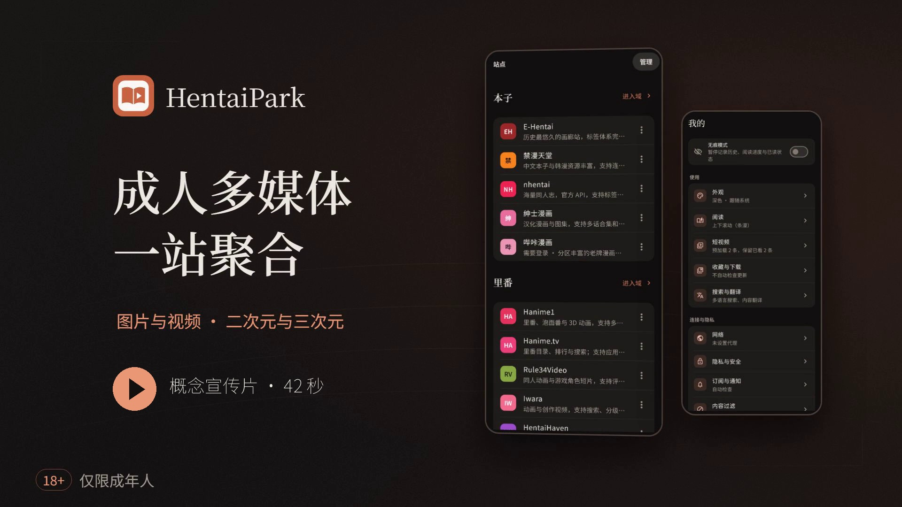

[简体中文](../../../README.md) · [繁體中文](../zh-Hant/README.md) · [日本語](../ja/README.md) · [한국어](../ko/README.md) · [English](README.md) · [Español](../es/README.md) · [Русский](../ru/README.md) · [العربية](../ar/README.md)

<strong>An adult content client. Discover, read, watch and collect in one place.</strong>

Browse doujinshi, hentai anime, JAV, photo galleries, videos, novels and games, then pick up where you left off.

  
  
  

<a href="https://github.com/drdon1234/Hentai-Park/releases/latest">Download</a> · <a href="#screenshots">Product demo</a> · <a href="#features">Features</a> · <a href="#faq">FAQ</a> · <a href="https://github.com/drdon1234/Hentai-Park/issues">Feedback</a>

> **18+** Adults only, where permitted by local law. Content comes from third-party sites; HentaiPark does not host it.

## Download and platforms

**[Download](https://github.com/drdon1234/Hentai-Park/releases/latest)**

Available for **Android 7.0+ and Windows**. Most Android phones and tablets use `arm64-v8a`; extract portable Windows ZIP archives completely.

The project targets only Android, Windows, and Web. The Web version is planned and is not yet available.

On Windows, confirming an update downloads and verifies the installer, opens it, and exits the app. Follow the system prompts to finish installation. Portable ZIP archives contain a fixed `HentaiPark` directory.

[Platforms and installation](../../PLATFORMS.md)

## Product demo

**[Watch the concept film (42 seconds, MP4, Chinese captions)](../../media/overview.mp4)**

Adult multimedia in one place. Explore illustrated and photographic galleries alongside animation and live-action video, with cover browsing, gallery details, cross-site search, favorites, downloads, subscription notifications, rankings, reverse image search, site comments, translation, filtering, cover blur and backups

<table>
  <tr>
    <td width="33%"></td>
    <td width="33%"></td>
    <td width="33%"></td>
  </tr>
  <tr><td align="center">Browse categories</td><td align="center">Work details · Read and save</td><td align="center">Light theme · Site entries</td></tr>
</table>

## Get started

1. In Discover, choose a category and browse sites, or search by work, tag, link or video code.
2. Open a work to read or watch. Add it to Favorites, or download it for offline use.
3. Resume from Home → Continue → All, and check new chapters in Favorites → Updates.

Configure sign-in under More → Sites and proxies under More → Network when needed.

## Features

| Feature | What you get |
| --- | --- |
| Discover and search | Filter by 2D, 3D and media type; search across sites, or jump to a work using a link or code. |
| Read and watch | Scrolling, paged and two-page comics; video episodes, speed and resume; novel bookmarks, notes and read-aloud. |
| Favorites and updates | Organize favorites, keep your progress, check new chapters and follow creators, channels or keywords. |
| Offline and export | Download comics, videos, novels and game resources; import and export CBZ, and export completed gallery chapters as PDF. |
| Rankings and image search | Browse doujinshi, anime and JAV rankings, or use an image to find candidate works. |
| Work information | Open JAV ranking details for available cast, release information, preview images and magnets, then search JAV sites in the app. |
| Site comments and live chat | Read comments, replies and images from supported sites, and show live chat in supported streams. |
| Translation and filters | Translate titles, descriptions, tags and novel text; hide content by tag. |
| Privacy and backup | App lock, incognito browsing, blurred covers and screenshot blocking on supported platforms; back up favorites, progress, subscriptions and settings. |

## Supported sites and services

[View all sites, rankings and reverse image search services](SITES.md)

## Limitations and FAQ

Reading, playback, comments, subscriptions and downloads vary by site. Check what the app offers for each site. Site updates may require an app upgrade.

**A site will not open or content is unavailable?**

Check your connection, then sign in, confirm your age or complete site verification as prompted. Some regions may require a VPN or proxy; content and access are controlled by the original site.

**Can I send comments or live chat?**

Comments, replies and live chat are read-only. When a game resource site requires a reply to unlock a link, the reply is shown first and sent only after you confirm.

**How do I keep favorites and progress?**

Export or restore .parkbak under More → Backup. Restore merges data and excludes downloaded files. Site sign-in and confirmation state, including cookies, can be included optionally for use on another device. Expired or device-bound sessions may require verification again. Backups are unencrypted; store them securely.

**How do I report an issue?**

Use Issues and include the app version, site and steps to reproduce. Redact accounts, cookies, tokens, backups and full signed URLs.

---

[AGPL-3.0 · License](../../../LICENSE) · [Third-party notices](../../licenses/README.md) · [Platforms](../../PLATFORMS.md)
