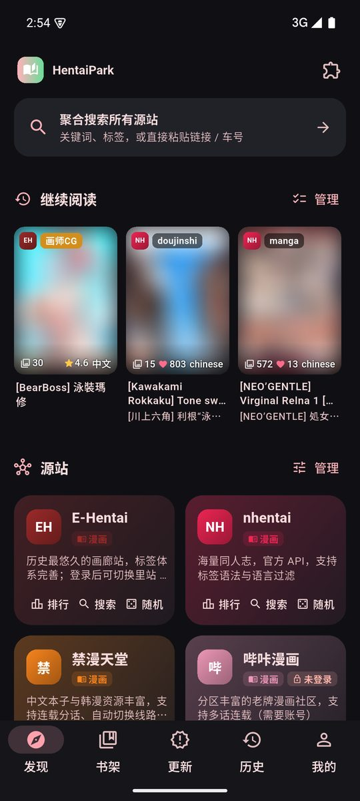
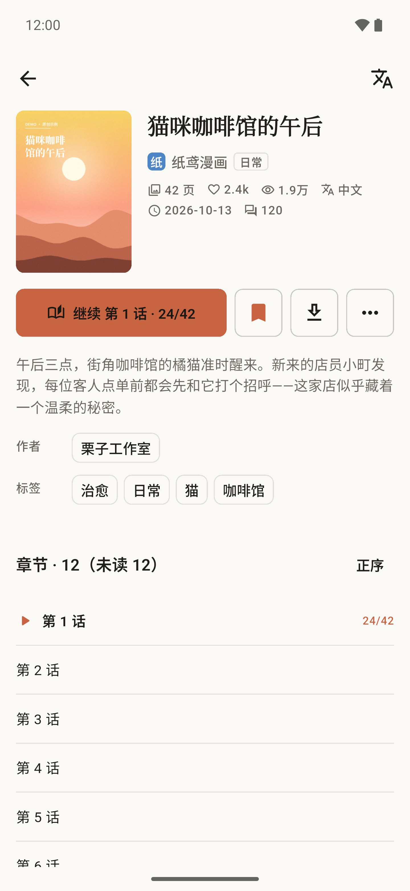
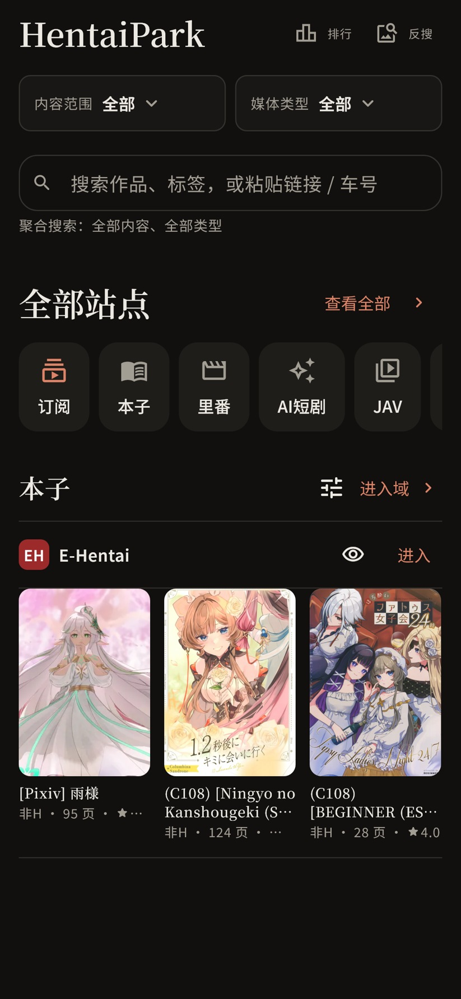
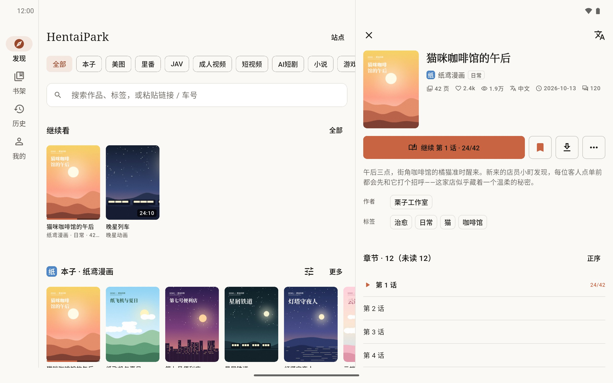
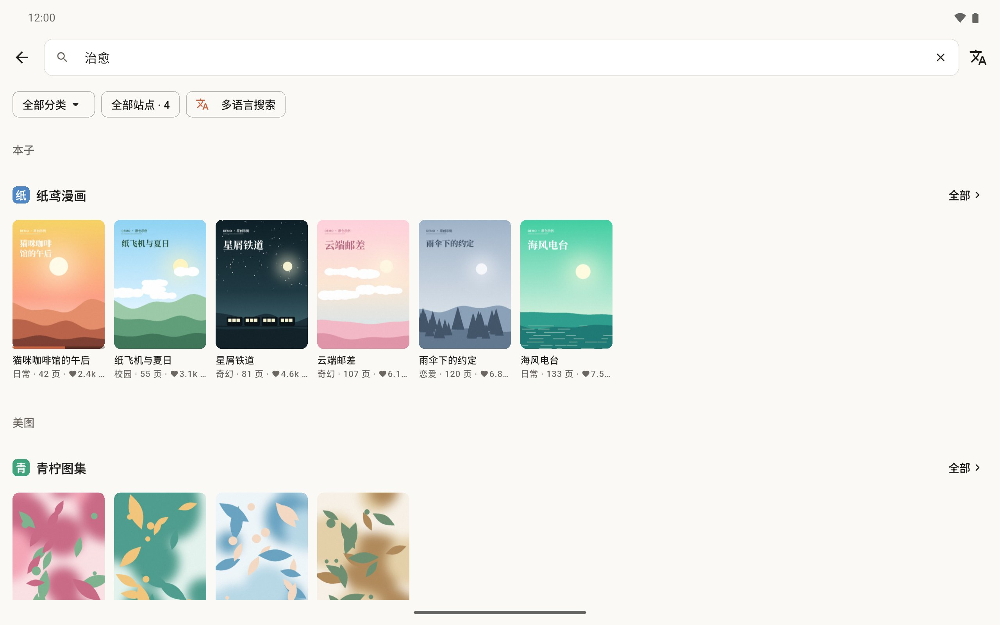

[简体中文](../../../README.md) · [繁體中文](../zh-Hant/README.md) · [日本語](../ja/README.md) · [한국어](../ko/README.md) · [English](README.md) · [Español](../es/README.md) · [Русский](../ru/README.md) · [العربية](../ar/README.md)

  

<strong>Comics, galleries, videos, novels and games — read and watch them all in one quiet app.</strong>

  
  

  <a href="https://github.com/drdon1234/Hentai-Park/releases/latest">Download</a> ·
  <a href="#screenshots">Screenshots</a> ·
  <a href="#features">Features</a> ·
  <a href="#faq">FAQ</a> ·
  <a href="https://github.com/drdon1234/Hentai-Park/issues">Feedback</a>

> For adults only, where permitted by local law. All content comes from third-party sites; HentaiPark neither stores nor provides any content.

## Download

Get the Android APK from the **[latest release](https://github.com/drdon1234/Hentai-Park/releases/latest)**. Most phones and tablets need `arm64-v8a`; emulators usually need `x86_64`.

Clients are available for Android, Windows, macOS and Linux. iOS/iPadOS currently has a simulator package only; Web is unavailable. See [installation and platform limits](../../PLATFORMS.md).

## Get started in three steps

1. **Discover**: open Discover and pick a category, or type a keyword, paste a link or a video code into the search box.
2. **Read and watch**: open a work and tap the main button. Add the ones you like to your Library.
3. **Pick up where you left off**: Continue at the top of Discover and History take you back to the exact spot; series you follow update under Library → Updates.

Sites that need an account or a proxy are set up in More → Sites and More → Network.

## Screenshots

<table>
  <tr>
    <td align="center" width="33%"></td>
    <td align="center" width="33%"></td>
    <td align="center" width="33%"></td>
  </tr>
  <tr>
    <td align="center">Discover</td>
    <td align="center">Details</td>
    <td align="center">Dark theme</td>
  </tr>
</table>

<table>
  <tr>
    <td align="center" width="50%"></td>
    <td align="center" width="50%"></td>
  </tr>
  <tr>
    <td align="center">Tablet landscape · Discover and details</td>
    <td align="center">Tablet landscape · Search across sites</td>
  </tr>
</table>

Screenshots use offline demo data; the sites, works and covers shown are original samples, not real content.

## Features

| Feature | What you get |
| --- | --- |
| Rankings | Open doujinshi, anime and JAV rankings from Discover; choose a site and period, search works or open the original site |
| Discover and search | Browse by category, search many sites at once, widen a search with keywords in other languages; paste a link or code to jump straight to a work |
| Read and watch | Comics scroll, page or show two-page spreads; videos have episodes, speed control and resume; novels have typography settings, bookmarks, notes and read-aloud. All three readers share the same controls |
| Library | Favorites with categories and new-chapter alerts; subscribe to creators, channels or keywords |
| Downloads | A dedicated main navigation tab for comic, video, novel and game downloads; import and export CBZ |
| Game resources | See game details, versions and download links |
| Translation and filters | Translate titles, descriptions and tags; hide works by tag |
| Privacy and backup | App lock, incognito mode, blurred covers, screenshot blocking; back up favorites, progress and settings |

Light and dark themes, eight interface languages. What each site supports is shown in the app.

## Supported sites

| Category | Sites |
| --- | --- |
| Doujinshi / comics | E-Hentai / ExHentai, Pixiv, nhentai, JMComic, WNACG, PicACG |
| Gallery | CosplayTele, NudeCosplay, XiuRen, PixiBB, PornPics |
| Adult animation | Hanime1, Hanime.tv, Rule34Video |
| JAV | MissAV, JableTV, SupJav, 123AV |
| Adult videos | Pornhub, XVideos, 91porn, iXXX, Thumbzilla, TubeSafari, SpankBang |
| Short videos | Pornhub Shorties, Fyptt, Tik.porn |
| AI short dramas | Huangguo Shorts, Huangdou Shorts, 91 Shorts |
| Novels | Book18, Cool18, Canovel, Literotica, Lush Stories, StoriesOnline, 69story |
| Games | GalgameX, KUN Galgame, Dimension Tea House |
| Subscriptions | X / Twitter, Telegram, myfans.jp, pixivFANBOX |

Enable, reorder, update or add sites in More → Sites.

## Rankings

| Category | Sites |
| --- | --- |
| Market rankings | FANZA、FC2、MGStage、一本道、天然むすめ、パコパコママ、Caribbeancom、DLsite、Toranoana |
| Site rankings | JavMenu、MissAV、JableTV、SupJav、JM、E-Hentai、WNACG、nhentai、Hanime1 |

Market rankings include works, actresses, sellers and categories; site rankings show popular content. Search works, open details or visit the original site.

iXXX and TubeSafari use in-app web playback. The playback page may require site confirmation; controls are provided by the upstream page. App downloads and precise playback resume are unavailable. Android requires a recent Android System WebView with isolated-session support.

## FAQ

**A site won't open, or images and videos fail to load?**
Check your connection first. Some sites may need a VPN or proxy in mainland China; set a proxy in More → Network. If a web check appears, pass it once in the built-in browser.

**Do I need site accounts?**
Mostly not. Sites that need one say so at the top of the site page, and you can sign in from that site's settings in More → Sites. Web sign-in for Pixiv, X and StoriesOnline supports third-party accounts such as Google and Apple; whether they allow the embedded browser is up to them.

**Will the app post or reply on my behalf?**
Never on its own. Some Dimension Tea House resources only unlock after a reply; the app shows you exactly what will be posted and sends it only after you confirm.

**How do I keep favorites and progress on a new phone?**
Export a backup in More → Backup and restore it on the new device. Downloads aren't included, and some sites may ask you to sign in again.

**What does translation send?**
Only the titles, descriptions and tags you choose to translate go to the translation service you picked. More → Search & translation lists exactly what is sent.

**How do I report a problem?**
Open an [issue](https://github.com/drdon1234/Hentai-Park/issues) with the app version, site name and steps to reproduce. Hide accounts and private content in screenshots.

---

[AGPL-3.0 license](../../../LICENSE) · [Third-party notices](../../licenses/README.md) · [Development](../../DEVELOPMENT.md) · [Site plugin API](SOURCE_API.md)
