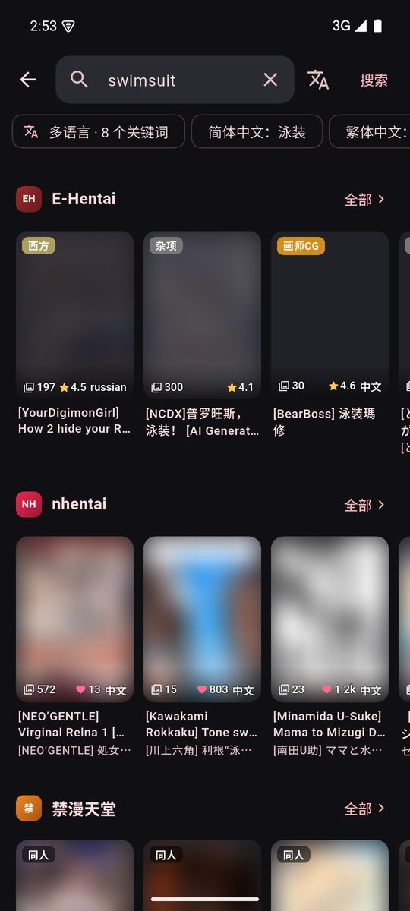
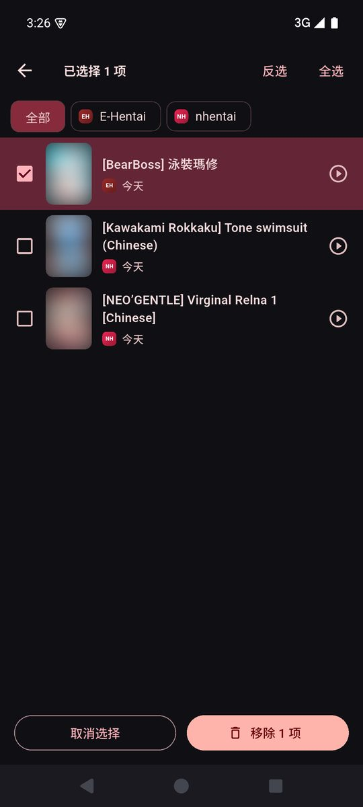

[简体中文](../../../README.md) · [繁體中文](../zh-Hant/README.md) · [日本語](../ja/README.md) · [한국어](../ko/README.md) · [English](README.md) · [Español](../es/README.md) · [Русский](../ru/README.md) · [العربية](../ar/README.md)

<p align="center">
  
</p>

<div align="center">

[](https://github.com/drdon1234/Hentai-Park/releases/latest)


</div>

> [!WARNING]
> This application involves adult content and can only be used by adults within the scope permitted by local laws. All content comes from third-party sites, and the App itself does not store or serve any content.

## Screenshots

<p align="center">
  
  
  
  
</p>

## Supported sources

| Source | Type | Description |
|------|------|------|
| E-Hentai / ExHentai | Comics | You can switch sites after logging in to the web page |
| nhentai | Comics | |
| JMComic | Comics | Open works by ID; switch API routes automatically |
| PicACG | Comics | Configure your own account, or automatically register a dedicated account after confirmation |
| Hanime1 | Video | First time use may require Cloudflare verification |

The source site is loaded as a plug-in, and third-party sources can be added in the settings.

## Features

- **Aggregation Search**: Search all source sites at once; paste the link or enter a work ID (such as `JM350234`) to directly open the work
- **Multi-language search**: Automatically translate keywords into Chinese/Japanese/Korean/English and other languages for simultaneous search
- **Library and updates**: Multi-category collection, automatically checks for serial updates and sends push notifications, and can automatically download new chapters
- **Reader**: Vertical scrolling, left-to-right and right-to-left reading, double page, white margin cropping, eye protection filter, volume key to turn pages
- **Video playback**: quality selection, playback speed and saved playback position; slide up and down on the left and right sides to adjust brightness and volume, drag horizontally to adjust progress; supports landscape and portrait fullscreen, including upside-down orientations
- **Download**: Download comics by chapter, download videos by quality; supports import and export CBZ
- **Source change migration**: Migrate collections to another source and retain reading progress
- **Blocking Tags**: Customize blocking and provide preset groupings that can be enabled on demand
- **Privacy Protection**: App lock, incognito mode, cover blur, anti-screenshot
- **Backup and Recovery**: One-click backup of library, progress and settings, supports scheduled automatic backup
- **Eight-language interface**: Simplified Chinese, Traditional Chinese, Japanese, Korean, English, Spanish, Russian, Arabic; supports following the system and instant switching, Arabic adopts a right-to-left layout

## Download

Go to [Releases](https://github.com/drdon1234/Hentai-Park/releases/latest) to download the latest version. When not sure which to choose, choose version `arm64-v8a` for most phones.

## Get started

1. Select the source site in "Discover", or use the search bar to search for the work, paste the link to the work, and enter a work ID. Multilingual search retains original keywords and detected source languages, while displaying translated keywords.
2. Select the language in "More → Language → App language". Follow the system by default; modifications will take effect immediately and be saved locally, without affecting the original title, tags or saved user data of the work.
3. Enable, sort and configure origin sites in "More → Manage sources". When no PicACG account is configured, "Discover" will display a prompt, and you can enter self-configuration or enable a dedicated automatic maintenance account.
4. When turning on PicACG "Use dedicated automatic maintenance account", a registration confirmation will pop up. After confirmation, create a dedicated account and log in immediately. Subsequent login status will be maintained by the application. Turning off the switch will retain the dedicated account; turning it on again can be reused, and existing manual accounts will not be overwritten. If registration fails, you can try again with the same account.
5. On the comic details page, you can collect, select categories and download chapters; "Bookshelf" organizes collections, "Update" checks new chapters, and "History" and continue reading restore progress. "More → Backup and Restore" can export data and merge it with the current data during restore.

Swipe up and down on the left side of the video page to adjust the brightness, slide up and down on the right side to adjust the volume, slide horizontally to preview the progress, and jump after letting go. The playback control provides horizontal and vertical screen expansion, and the operating area adjusts with the display direction when the screen is rotated. The reader supports scrolling up and down, turning pages from left to right or right to left, and the reading direction is determined by the reader settings.

## FAQ

**PicACG / ExHentai cannot be used?**
PicACG needs to configure the account by itself or confirm the registration of a dedicated automatic maintenance account; ExHentai requires web login, and the account itself must have site permissions.

**Images loading slowly or failing?**
You can configure the HTTP proxy in the settings; JMComic / PicACG can try to switch image server.

**Hanime1 Keep spinning in circles?**
Follow the prompts to complete the Cloudflare verification in the built-in browser.

## Development

```bash
flutter pub get
flutter build apk --release --split-per-abi
```

To write a source plugin for a new site, please refer to [Source plugin development guide](SOURCE_API.md). The built-in source plug-in version starts from `0.0.1`; the application version and plug-in version are managed separately.
