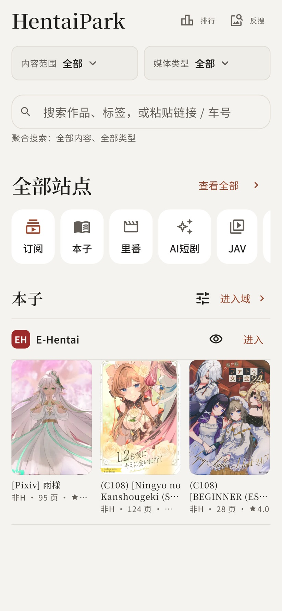

[简体中文](../../../README.md) · [繁體中文](../zh-Hant/README.md) · [日本語](../ja/README.md) · [한국어](../ko/README.md) · [English](../en/README.md) · [Español](../es/README.md) · [Русский](README.md) · [العربية](../ar/README.md)

<strong>Клиент контента для взрослых. Поиск, чтение, просмотр и избранное в одном месте.</strong>

Додзинси, хентай-аниме, JAV, фотогалереи, видео, романы и игры — выбирайте интересное и продолжайте с места остановки.

  
  
  

<a href="https://github.com/drdon1234/Hentai-Park/releases/latest">Скачать</a> · <a href="#screenshots">Демонстрация</a> · <a href="#features">Возможности</a> · <a href="#faq">Вопросы</a> · <a href="https://github.com/drdon1234/Hentai-Park/issues">Обратная связь</a>

> **18+** Только для совершеннолетних, если это разрешено местным законодательством. Контент поступает со сторонних сайтов; HentaiPark его не размещает.

## Загрузка и платформы

**[Скачать](https://github.com/drdon1234/Hentai-Park/releases/latest)**

Поддерживаются **Android 7.0+ и Windows**. Для большинства устройств Android выбирайте `arm64-v8a`; портативные ZIP для Windows нужно распаковать целиком.

Проект ориентирован только на Android, Windows и Web. Веб-версия запланирована, но пока недоступна.

В Windows после подтверждения обновления приложение скачивает и проверяет установщик, открывает его и закрывается. Завершите установку по подсказкам системы. Портативные ZIP содержат каталог `HentaiPark`.

[Платформы и установка](../../PLATFORMS.md)

## Демонстрация

https://github.com/user-attachments/assets/165f1524-9084-4437-bebb-fa9e23ebd316

<table>
  <tr>
    <td width="33%"></td>
    <td width="33%"></td>
    <td width="33%"></td>
  </tr>
  <tr><td align="center">Категории · Открытые обложки</td><td align="center">Произведение · Чтение и сохранение</td><td align="center">Светлая тема · Сайты</td></tr>
</table>

## Начало работы

1. В разделе «Обзор» выберите категорию и сайт или найдите произведение по названию, тегу, ссылке или коду.
2. Откройте произведение для чтения или просмотра. Добавьте в «Избранное» или скачайте для доступа без сети.
3. Продолжайте через Главная → Продолжить → Все, а новые главы смотрите в Избранное → Обновления.

При необходимости настройте вход в Ещё → Сайты и прокси в Ещё → Сеть.

## Возможности

| Функция | Возможности |
| --- | --- |
| Обзор и поиск | Фильтры 2D, 3D и типов контента, поиск по нескольким сайтам и переход по ссылке или коду. |
| Чтение и просмотр | Прокрутка, страницы и развороты комиксов; эпизоды, скорость и продолжение видео; закладки, заметки и озвучивание романов. |
| Избранное и обновления | Группы, сохранение прогресса и новые главы. Подписки на авторов, каналы и ключевые слова. |
| Офлайн и экспорт | Загрузка комиксов, видео, романов и игровых ресурсов; импорт и экспорт CBZ, экспорт завершённых глав галерей в PDF. |
| Рейтинги и поиск по картинке | Рейтинги додзинси, аниме и JAV, поиск возможных произведений по изображению. |
| Сведения о произведениях | Откройте сведения из рейтинга JAV: исполнители, выпуск, кадры и magnet-ссылки, затем найдите произведение на сайтах JAV в приложении. |
| Комментарии и чат | Чтение комментариев, ответов и изображений на поддерживаемых сайтах, отображение чата в поддерживаемых трансляциях. |
| Перевод и фильтры | Перевод названий, описаний, тегов и текста романов. Скрытие контента по тегам. |
| Конфиденциальность и копии | Блокировка приложения, инкогнито, размытие обложек и запрет снимков на поддерживаемых платформах. Копирование избранного, прогресса, подписок и настроек. |

## Поддерживаемые сайты и сервисы

[Все сайты, рейтинги и сервисы обратного поиска изображений](SITES.md)

## Ограничения и вопросы

Чтение, воспроизведение, комментарии, подписки и загрузка зависят от сайта. Ориентируйтесь на доступные в приложении возможности. Обновление сайта может требовать новой версии приложения.

**Сайт или контент недоступен?**

Проверьте подключение и при необходимости войдите, подтвердите возраст или пройдите проверку сайта. В отдельных регионах нужен VPN или прокси; контент и доступ определяет исходный сайт.

**Можно отправлять комментарии и сообщения?**

Комментарии, ответы и чат трансляций доступны только для чтения. Если игровой ресурс требует ответа для разблокировки, приложение сначала показывает текст и отправляет его только после подтверждения.

**Как сохранить избранное и прогресс?**

Экспортируйте или восстановите .parkbak в Ещё → Резервное копирование. Восстановление объединяет данные и не включает загруженные файлы. Состояние входа и подтверждения сайтов, включая Cookie, можно добавить для переноса на другое устройство. Просроченные или привязанные к устройству сеансы могут потребовать повторной проверки. Копии не зашифрованы — храните их безопасно.

**Как сообщить об ошибке?**

Создайте Issue с версией приложения, сайтом и шагами воспроизведения. Скройте учётные данные, Cookie, Token, резервные копии и полные подписанные ссылки.

---

[AGPL-3.0 · Лицензия](../../../LICENSE) · [Сторонние компоненты](../../licenses/README.md) · [Платформы](../../PLATFORMS.md)
