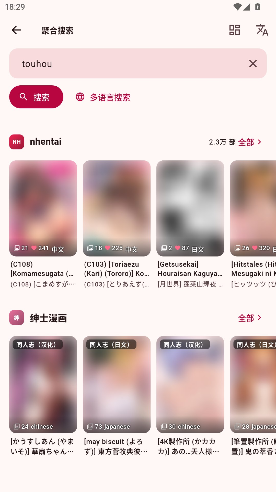
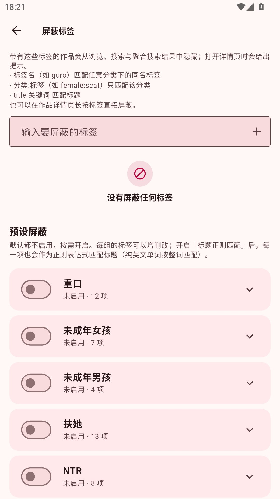

[简体中文](../../../README.md) · [繁體中文](README.md) · [日本語](../ja/README.md) · [한국어](../ko/README.md) · [English](../en/README.md) · [Español](../es/README.md) · [Русский](../ru/README.md) · [العربية](../ar/README.md)

  

<strong>漫畫、圖集、影片、小說與遊戲，一個應用輕鬆瀏覽。</strong>

  
  

  <a href="https://github.com/drdon1234/Hentai-Park/releases/latest">下載應用</a> ·
  <a href="#screenshots">介面預覽</a> ·
  <a href="#faq">常見問題</a> ·
  <a href="https://github.com/drdon1234/Hentai-Park/issues">回報問題</a>

> 僅限成年人在當地法律允許的範圍內使用。內容來自第三方站點。

## 下載與開始使用

在 **[最新版本](https://github.com/drdon1234/Hentai-Park/releases/latest)** 下載並安裝 Android APK。大多數手機和平板選擇 `arm64-v8a`；模擬器通常選擇 `x86_64`。

1. **找內容**：開啟「發現」，選擇分類與站點，或直接搜尋。
2. **開始看**：開啟作品閱讀或播放，喜歡的內容加入「書架」。
3. **接著看**：從最近瀏覽繼續，或在「書架」「更新」查看收藏與追更。

需要登入的站點可在「我的 → 源站管理」設定；部分站點可能需要 VPN 或代理。

## 介面預覽

手機直向與平板橫向截圖來自 MuMu 模擬器，以亮色模式展示；封面已模糊處理。

  
  
  

發現 · 搜尋 · 內容封鎖

  
  

平板橫向：更寬的瀏覽與搜尋空間

暗色模式對比

  

## 主要功能

| 功能 | 你可以做什麼 |
| --- | --- |
| **瀏覽與搜尋** | 按分類發現內容，同時搜尋多個站點；以多語言關鍵字擴大搜尋範圍 |
| **閱讀與觀看** | 漫畫捲動、翻頁或雙頁閱讀；影片選集、倍速與續播；小說調整排版或朗讀 |
| **收藏與追更** | 收藏分組、儲存進度，訂閱作品、關鍵字、作者或頻道更新 |
| **離線使用** | 下載支援的漫畫、影片與小說；匯入、匯出 CBZ 漫畫 |
| **遊戲資源** | 瀏覽遊戲介紹、版本與下載連結，儲存或匯出下載檔案 |
| **翻譯與篩選** | 翻譯標題、簡介和標籤，封鎖不想看的內容 |
| **隱私與備份** | 應用鎖、無痕模式、封面模糊、防截圖；備份收藏、進度與設定 |

支援亮色、暗色主題及八種介面語言。各站點可用功能以應用內入口為準。

## 支援的站點

涵蓋本子、漫畫、美圖、成人動畫、JAV、成人影片、短影片、AI 短劇、小說和遊戲，也可集中瀏覽訂閱的創作者與頻道。

展開站點清單

| 分類 | 站點 |
| --- | --- |
| 本子 / 漫畫 | E-Hentai / ExHentai、Pixiv、nhentai、禁漫天堂、WNACG、哔咔漫画 |
| 美圖 | CosplayTele、NudeCosplay、XiuRen、PixiBB、PornPics |
| 成人動畫 | Hanime1、Hanime.tv、Rule34Video |
| JAV | MissAV、JableTV、SupJav、123AV |
| 成人影片 | Pornhub、XVideos、91porn、iXXX、Thumbzilla、TubeSafari、SpankBang |
| 短影片 | Pornhub Shorties、Fyptt、Tik.porn |
| AI 短劇 | 黄果短剧、黄豆短剧、91短剧 |
| 小說 | Book18、Cool18、Canovel、Literotica、Lush Stories、StoriesOnline、69story |
| 遊戲 | GalgameX、KUN Galgame、次元茶馆 |
| 使用者 / 頻道訂閱 | X / Twitter、Telegram、myfans.jp、pixivFANBOX |

次元茶館部分資源需要登入並回覆解鎖；點擊解鎖按鈕會在原帖發送「感谢分享，好人一生平安」。

在「我的 → 源站管理」啟用、排序或新增站點。軟體與官方源站更新可依應用提示安裝。

## 常見問題

**站點無法開啟，或圖片、影片載入失敗？** 先檢查網路，必要時嘗試 VPN 或在網路設定中配置代理。出現網頁驗證時，依提示完成後重試。

**需要站點帳號嗎？** 部分站點需要登入或相應存取權限，應用會提示。可在「我的 → 源站管理」開啟對應站點設定。

**如何接收更新提醒？** 在作品詳情或「發現 → 訂閱」新增訂閱，再到「我的 → 訂閱與通知設定」開啟通知並授予系統權限。

**換裝置如何保留收藏與進度？** 在「我的 → 備份與還原」匯出備份，在新裝置還原。離線下載另行儲存，站點帳號可能需要重新登入。

**如何回報問題？** 在 [Issues](https://github.com/drdon1234/Hentai-Park/issues) 提供應用版本、站點名稱與重現步驟；截圖前隱藏帳號與私人內容。

---

[AGPL-3.0 授權](../../../LICENSE) · [第三方聲明](../../licenses/README.md) · [開發說明](../../DEVELOPMENT.md)
